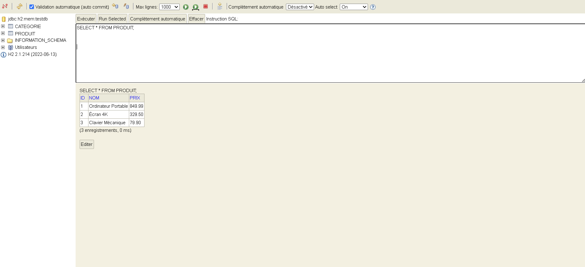

# Console Output

<div style="border: 2px solid #4a5568; border-radius: 8px; padding: 16px; background-color: #1e1e1e;">

```text
>> Console H2 accessible sur : http://localhost:8082
oct. 10, 2026 6:07:43 PM org.hibernate.jpa.internal.util.LogHelper logPersistenceUnitInformation
INFO: HHH000204: Processing PersistenceUnitInfo [name: hibernate-demo]
oct. 10, 2026 6:07:43 PM org.hibernate.Version logVersion
INFO: HHH000412: Hibernate ORM core version 5.6.5.Final
oct. 10, 2026 6:07:44 PM org.hibernate.annotations.common.reflection.java.JavaReflectionManager <clinit>
INFO: HCANN000001: Hibernate Commons Annotations {5.1.2.Final}
oct. 10, 2026 6:07:44 PM org.hibernate.engine.jdbc.connections.internal.DriverManagerConnectionProviderImpl configure
WARN: HHH10001002: Using Hibernate built-in connection pool (not for production use!)
oct. 10, 2026 6:07:44 PM org.hibernate.engine.jdbc.connections.internal.DriverManagerConnectionProviderImpl buildCreator
INFO: HHH10001005: using driver [org.h2.Driver] at URL [jdbc:h2:mem:testdb;DB_CLOSE_DELAY=-1]
oct. 10, 2026 6:07:44 PM org.hibernate.engine.jdbc.connections.internal.DriverManagerConnectionProviderImpl buildCreator
INFO: HHH10001001: Connection properties: {user=sa, password=****}
oct. 10, 2026 6:07:44 PM org.hibernate.engine.jdbc.connections.internal.DriverManagerConnectionProviderImpl buildCreator
INFO: HHH10001003: Autocommit mode: false
oct. 10, 2026 6:07:44 PM org.hibernate.engine.jdbc.connections.internal.DriverManagerConnectionProviderImpl$PooledConnections <init>
INFO: HHH000115: Hibernate connection pool size: 20 (min=1)
oct. 10, 2026 6:07:44 PM org.hibernate.dialect.Dialect <init>
INFO: HHH000400: Using dialect: org.hibernate.dialect.H2Dialect
oct. 10, 2026 6:07:45 PM org.hibernate.resource.transaction.backend.jdbc.internal.DdlTransactionIsolatorNonJtaImpl getIsolatedConnection
INFO: HHH10001501: Connection obtained from JdbcConnectionAccess [org.hibernate.engine.jdbc.env.internal.JdbcEnvironmentInitiator$ConnectionProviderJdbcConnectionAccess@3a175162] for (non-JTA) DDL execution was not in auto-commit mode; the Connection 'local transaction' will be committed and the Connection will be set into auto-commit mode.
Hibernate: 
    
    create table Categorie (
       id bigint generated by default as identity,
        nom varchar(255),
        primary key (id)
    )
Hibernate: 
    
    create table Produit (
       id bigint generated by default as identity,
        nom varchar(255),
        prix numeric(19,2),
        primary key (id)
    )
oct. 10, 2026 6:07:45 PM org.hibernate.engine.transaction.jta.platform.internal.JtaPlatformInitiator initiateService
INFO: HHH000490: Using JtaPlatform implementation: [org.hibernate.engine.transaction.jta.platform.internal.NoJtaPlatform]
Hibernate: 
    insert 
    into
        Produit
        (id, nom, prix) 
    values
        (default, ?, ?)
Hibernate: 
    insert 
    into
        Produit
        (id, nom, prix) 
    values
        (default, ?, ?)
Hibernate: 
    insert 
    into
        Produit
        (id, nom, prix) 
    values
        (default, ?, ?)
>> Insertion réussie des articles en base de données !
Hibernate: 
    select
        produit0_.id as id1_1_,
        produit0_.nom as nom2_1_,
        produit0_.prix as prix3_1_ 
    from
        Produit produit0_

=== Consultation des produits enregistrés ===
 - Produit [id=1, nom=Ordinateur Portable, prix=849.99 €]
 - Produit [id=2, nom=Écran 4K, prix=329.50 €]
 - Produit [id=3, nom=Clavier Mécanique, prix=79.90 €]

=== Recherche du produit (identifiant = 2) ===
 Article trouvé : Produit [id=2, nom=Écran 4K, prix=329.50 €]

--> Appuyez sur [Entrée] pour quitter l'application...
```

</div>

# H2 Web Console


